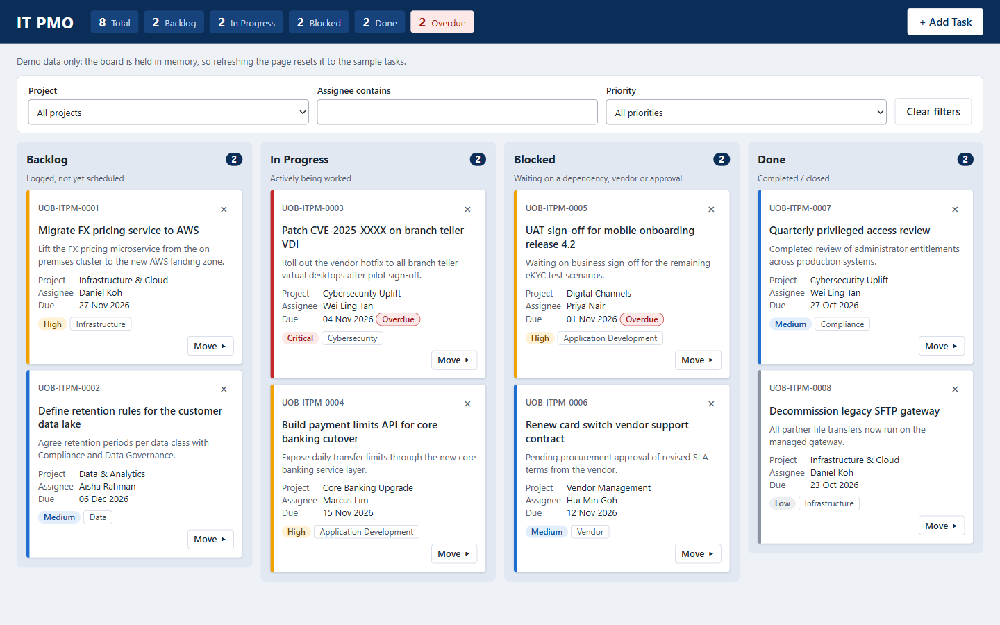

# kanban9

An IT project management Kanban board for a fictitious bank's IT PMO, built for demos and training. The whole app is one `index.html` file of vanilla HTML, CSS and JavaScript.

**Live demo:** <https://alfredang.github.io/kanban9/>



**All tasks, people and projects are sample data.** The board is held in memory, so refreshing the page resets it to the sample tasks.

## Features

- Four columns: Backlog, In Progress, Blocked and Done
- A summary strip with total, per-status and overdue counts
- Filters by project, assignee and priority
- Add and delete tasks, with inline validation and an inline delete confirmation
- Move cards by drag and drop, or with the Move ▸ control on keyboard and touch devices
- An optional email notification for each new task, sent through [FormSubmit](https://formsubmit.co)

## Run it locally

Open `index.html` directly by double-clicking it. There is nothing to install or build.

To test email sending, serve the folder over http instead, because FormSubmit rejects pages opened from `file://`:

```
python -m http.server
```

Then open <http://localhost:8000>.

## Configuration

The settings are constants at the top of the script in `index.html`:

| Constant | Purpose |
| --- | --- |
| `FORMSUBMIT_ENDPOINT` | Where new-task notifications are sent. Replace `YOUR_EMAIL@example.com` with a real address. |
| `TASK_ID_PREFIX` | Prefix for task IDs |
| `EMAIL_SUBJECT_TAG` | Tag at the start of the email subject |

Email is off until you set the address: while the placeholder is in place, the page makes no network call and adds the task anyway.

FormSubmit also needs a one-time activation. The first submission sends a confirmation email to the address, and nothing is delivered until its link is clicked.

> [!WARNING]
> This repository is public. Committing a real address to `FORMSUBMIT_ENDPOINT` publishes it in the source and on the live site.

## Deployment

Each push to `main` deploys the repository root to GitHub Pages through [.github/workflows/pages.yml](.github/workflows/pages.yml). There is no build step.

## Contributing

There is no test suite, linter or package manifest. To check a change, drive the page in a real browser, and stub `fetch` to cover each email outcome: success, a 500, `success: "false"` in a 200 response, and a network failure.

Keep to these project rules:

- **No dependencies:** use vanilla HTML, CSS and JS, with no frameworks, build tools, CDNs, web fonts or external images.
- **No storage:** don't use `localStorage`, `sessionStorage`, `indexedDB` or cookies.
- **Opening the file must keep working:** the board has to run from a double-clicked `index.html`.
- **No browser dialogs or `!important`:** don't use `alert()`, `confirm()` or `!important`. Validation errors and the delete confirmation are inline.
- **Rendering:** change `state`, then call `renderBoard()`, which rebuilds the board with `innerHTML`. Escape user text with `escapeHtml()`, use delegated listeners on `#board`, and restore focus after keyboard actions.
- **Moving cards:** Move ▸ is the only way to move cards by keyboard or touch, so it can't be removed in favour of drag and drop.
- **Email failures:** a failed email only shows a warning toast. It must never change the board.
- **Dates:** due dates are local-time `YYYY-MM-DD` strings, so use `todayIso()` rather than `toISOString()`.

[CLAUDE.md](CLAUDE.md) has more detail on the architecture.
