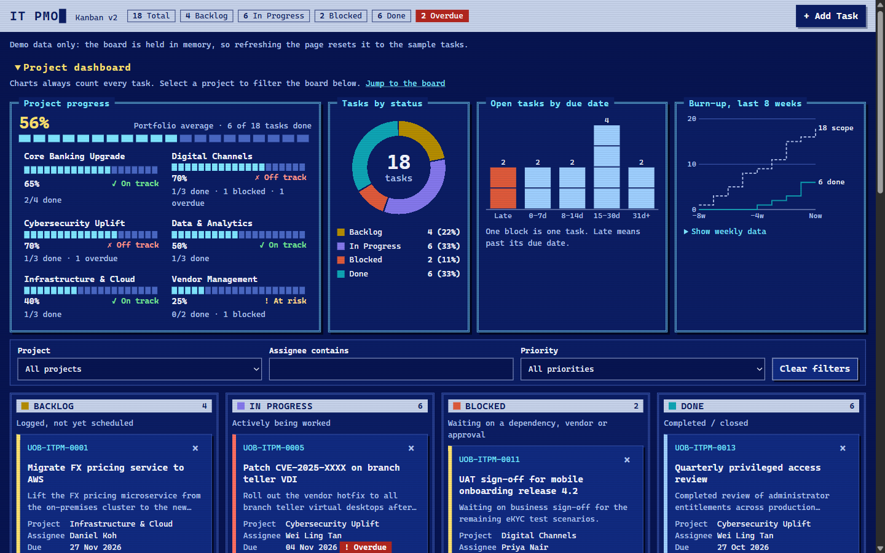

# kanban9

An IT project management Kanban board for a fictitious bank's IT PMO, built for demos and training. Each version is one HTML file of vanilla HTML, CSS and JavaScript.

| Version | Live site | Source | What it is |
| --- | --- | --- | --- |
| **v2** | <https://alfredang.github.io/kanban9/v2/> | [`v2/index.html`](v2/index.html) | Retro terminal look, project charts and progress, hardened security |
| **v1** | <https://alfredang.github.io/kanban9/> | [`index.html`](index.html) | The original board, kept unchanged |



**All tasks, people and projects are sample data.** The board is held in memory, so refreshing the page resets it to the sample tasks.

## Features

Both versions have:

- Four columns: Backlog, In Progress, Blocked and Done
- A summary strip with total, per-status and overdue counts
- Filters by project, assignee and priority
- Add and delete tasks, with inline validation and an inline delete confirmation
- Move cards by drag and drop, or with the Move ▸ control on keyboard and touch devices
- An optional email notification for each new task, sent through [FormSubmit](https://formsubmit.co)

v2 adds:

- **Project progress:** percent complete and a health label for each project, plus a portfolio average. Select a project to filter the board.
- **Charts:** tasks by status, open tasks by due date, and an eight-week burn-up. All are inline SVG, with no chart library.
- **Task progress:** a block progress bar on every card, with 10% steps for work in progress. Backlog is always 0% and only Done reaches 100%.
- **Security hardening:** a strict Content Security Policy, Trusted Types and stricter input checks. See [SECURITY.md](SECURITY.md).

## Run it locally

Open `v2/index.html` or `index.html` directly by double-clicking it. There is nothing to install or build.

To test email sending, serve the folder over http instead, because FormSubmit rejects pages opened from `file://`:

```
python -m http.server
```

Then open <http://localhost:8000/v2/>.

## Configuration

The settings are constants at the top of the script in each page:

| Constant | Purpose |
| --- | --- |
| `FORMSUBMIT_ENDPOINT` | Where new-task notifications are sent. Replace `YOUR_EMAIL@example.com` with a real address, or with the alias FormSubmit issues. |
| `TASK_ID_PREFIX` | Prefix for task IDs |
| `EMAIL_SUBJECT_TAG` | Tag at the start of the email subject |

Email is off until you set the address: while the placeholder is in place, the page makes no network call and adds the task anyway.

FormSubmit also needs a one-time activation. The first submission sends a confirmation email to the address, and nothing is delivered until its link is clicked.

> [!WARNING]
> This repository is public. Committing a real address to `FORMSUBMIT_ENDPOINT` publishes it in the source and on the live site. Use the random alias FormSubmit issues after activation.

After editing v2, including its configuration, update the security policy hashes, or the page won't load:

```
python .github/scripts/check_site.py --write
```

## Deployment

The [CI/CD workflow](.github/workflows/pages.yml) has two jobs, and there is no build step:

- **`verify`** runs on pushes to `main` and on pull requests. It checks that v1 is unchanged, checks v2's security policy and project rules, and scans new commits for secrets with Gitleaks. Starting the workflow manually scans the whole git history instead.
- **`deploy`** publishes `index.html` and `v2/index.html` to GitHub Pages, and nothing else from the repository. It runs only from `main`, and only after `verify` passes.

## Contributing

There is no test suite or package manifest. To check a change, drive the page in a real browser, and stub `fetch` to cover each email outcome: success, a 500, `success: "false"` in a 200 response, and a network failure.

Make changes in `v2/`. CI fails if the root `index.html` changes, because v1 is frozen.

Keep to these project rules:

- **No dependencies:** use vanilla HTML, CSS and JS, with no frameworks, build tools, CDNs, web fonts or external images.
- **No storage:** don't use `localStorage`, `sessionStorage`, `indexedDB` or cookies.
- **Opening the file must keep working:** the board has to run from a double-clicked file.
- **No browser dialogs or `!important`:** don't use `alert()`, `confirm()` or `!important`. Validation errors and the delete confirmation are inline.
- **Rendering:** change `state`, then call `renderBoard()`, which rebuilds the board. In v2, insert HTML only with `setHtml()`. Escape user text with `escapeHtml()`, use delegated listeners on `#board`, and restore focus after keyboard actions.
- **Moving cards:** Move ▸ is the only way to move cards by keyboard or touch, so it can't be removed in favour of drag and drop.
- **Email failures:** a failed email only shows a warning toast. It must never change the board.
- **Dates:** due dates are local-time `YYYY-MM-DD` strings, so use `todayIso()` rather than `toISOString()`.

[CLAUDE.md](CLAUDE.md) has more detail on the architecture.
